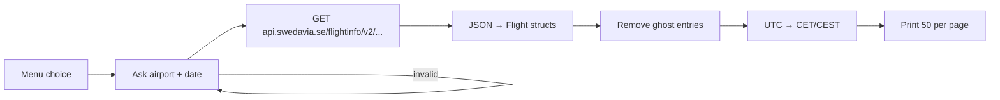

# Swedavia FlightInfo – Reverse Engineering Project (Rust)

> APL project 2026 – Task 4: *Reverse Engineer a Result*
> All documentation and the video are in **English** (course requirement).

## 1. Goal

We were given a finished application: a **Python terminal client for the Swedavia
FlightInfo API v2** (shown in the video *"Buster Swedavia FlightInfo API v2"*).
The task is to work backwards from what it shows – the data, the menus and the output –
then **rebuild it in Rust** with similar output, and do it better where we can.

---

## 2. Observations from the original application (Step 1 – "Look at the application")

What the video shows:

| Area | What we saw |
|---|---|
| Language / files | Python 3.13, `airport.py` (main), `destinationer.py` (helper), `city_country.json`, `README.md`, `FÖRKLARING.md` |
| API | Base URL `https://api.swedavia.se/flightinfo/v2`, header `Ocp-Apim-Subscription-Key`, `Accept: application/json` |
| Main menu | 1 Arrivals for airport + date · 2 Departures for airport + date · 3 Search flight number · 4 OData query (`query` endpoint) · 5 HeartBeat (API health) · 6 Run a demo of all endpoints · q Quit |
| Airports | 10 Swedavia airports as IATA codes: ARN, GOT, BMA, MMX, LLA, UME, OSD, VBY, RNB, KRN |
| Input | Airport as IATA code **or** city name (`arn`, `Visby`) → alias table. Date as `YYYY-MM-DD`, `nu`, `idag`, `imorgon`, `igår` |
| Output per flight | `[n] → SK532 \| SAS-Scandinavian Airlines (SK)`, From, To, Status (Scheduled/Departed), Terminal, Gate, Baggage belt, Sched/Est/Actual as `16:25 UTC → 17:25 CET`, D/I (domestic/international), Remarks |
| Paging | 50 flights per page: `── Showing 50/220 ── (170 left)` · `[Enter] next page \| [a] show all \| [q] back to menu` |
| Logic helpers | `_fmt_time()` UTC → Europe/Stockholm (CET/CEST) · `_is_valid_flight()` filters out "ghost entries" where all key fields are empty · `_is_upcoming()` (no `actualUtc` = not yet departed/landed) · `_choose_airport()` loops until valid input |
| Destinations | `destinationer.py` lists unique cities a day's flights go to/come from, with country and count, e.g. `Frankfurt (5 st) [Germany]`. Filter by country or city |
| `city_country.json` | Built from Swedavia's official statistics Excel file: 263 cities → 59 countries, `city_to_country` + `country_to_cities`. Used offline, no extra API calls |

**JSON fields we can infer** (verify against a real response in Phase 1):
`flightId`, `airlineOperator { name, iata }`, `departureAirportEnglish` / `arrivalAirportEnglish`,
`arrivalTime` / `departureTime { scheduledUtc, estimatedUtc, actualUtc }`,
`locationAndStatus { terminal, gate, flightLegStatusEnglish }`, `baggage { ... }`, a D/I flag, remarks.

**Scope rule:** this is reverse engineering, so we rebuild **only what the original does** – no new features.
The code must also stay small enough to walk through in under 5 minutes.

The only thing we deliberately do differently: the original has the **API key hard-coded** in the source
(visible in the video). We read it from a git-ignored `.env` file instead – that is a security fix, not a feature.

---

## 3. Reverse-engineering steps mapped to the task (Steps 2–6)

| Task step | What we do |
|---|---|
| 2. Ask questions | What data is this? (real-time flights) Who produces it? (Swedavia's API) Why UTC + CET? Why a "ghost" filter? |
| 3. Guess the inputs | API key, airport (code or city), date (`nu/idag/imorgon/igår/YYYY-MM-DD`), flight number, OData filter |
| 4. Guess the process | menu loop → check input → HTTP GET → JSON → filter → format times → print 50 per page |
| 5. Sketch the steps | Function names copied from the video: `_choose_airport`, `_fmt_time`, `_is_valid_flight`, `_is_upcoming`, `_print_flights_paged` |
| 6. Try building it | The Rust code in `src/` |

**Guesses we had to make** (not visible in the video):
- `nu` vs `idag`: the original offers both and has an `_is_upcoming()` helper, so `nu` = today, only flights that have not landed/departed.
- Menu 3 (flight search) asks for flight number, airport and date and searches both arrivals and departures.
- Menu 6 (demo) calls all four endpoints in a row.

---

## 4. Tech choices (Rust)

| Need | Crate |
|---|---|
| HTTP (simple, no async) | `reqwest` (blocking) |
| JSON → structs | `serde`, `serde_json` |
| UTC → Swedish time (CET/CEST) | `chrono`, `chrono-tz` |
| API key from `.env` | `dotenvy` |
| Simple error messages | `anyhow` |

---

## 5. Code structure (5 files, mirrors the original)

| File | What it does | Original |
|---|---|---|
| `src/main.rs` | The menu loop and the 6 menu options | `main()` in `airport.py` |
| `src/bin/destinationer.rs` | Destination overview with countries | `destinationer.py` |
| `src/api.rs` | JSON structs + 4 GET calls: `arrivals`, `departures`, `query`, `heartbeat` | `_get()`, `HEADERS`, `BASE_URL` |
| `src/input.rs` | Airport list, asking questions, parsing airport and date | `AIRPORTS`, `_choose_airport()` |
| `src/output.rs` | Time format, ghost filter, flight card, 50-per-page pager | `_fmt_time()`, `_is_valid_flight()`, `_print_flight()`, `_print_flights_paged()` |

`data/city_country.json` is built from Swedavia's destination statistics Excel file (2025), like the original.

### Main flow

---

## 6. Features (parity with the original)

- [x] 1 Arrivals for an airport and date
- [x] 2 Departures for an airport and date
- [x] 3 Search for a flight number
- [x] 4 OData query
- [x] 5 HeartBeat
- [x] 6 Demo of all endpoints
- [x] Paging 50 per page with `[Enter]` / `a` / `q`
- [x] Destinations overview with countries (`destinationer.py` + `city_country.json`)

---

## 7. Timeline (follows the four documentation phases)

| Phase | Work |
|---|---|
| **1. Research** | Watch the video, write down what the app does (§2), get an API key, call each endpoint once and save the JSON in `tests/fixtures/` |
| **2. Implementation** | `api.rs` → `input.rs` → `output.rs` → menu in `main.rs` → destinations |
| **3. Completion** | Test every menu option against the real API, README, push to GitHub |
| **4. Summary** | Problems and solutions from `DEVLOG.md`, conclusion, record the video |

**Tip:** write a line in `docs/DEVLOG.md` **every time** something goes wrong and how you solved it.

---

## 8. Video plan (4–5 minutes, in English)

1. **0:00–0:30** Purpose: "We were given a Python flight app as a video and rebuilt it in Rust by reverse engineering it."
2. **0:30–1:30** Research: screenshots from the original, what we could read from them, the API portal.
3. **1:30–3:30** Code walk-through, one file at a time (`api.rs` → `input.rs` → `output.rs` → `main.rs`) and a live run of the menu.
4. **3:30–4:30** Problems and solutions (3–4 from the DEVLOG) + conclusion.

Record with OBS. Have the key in `.env` before recording.
